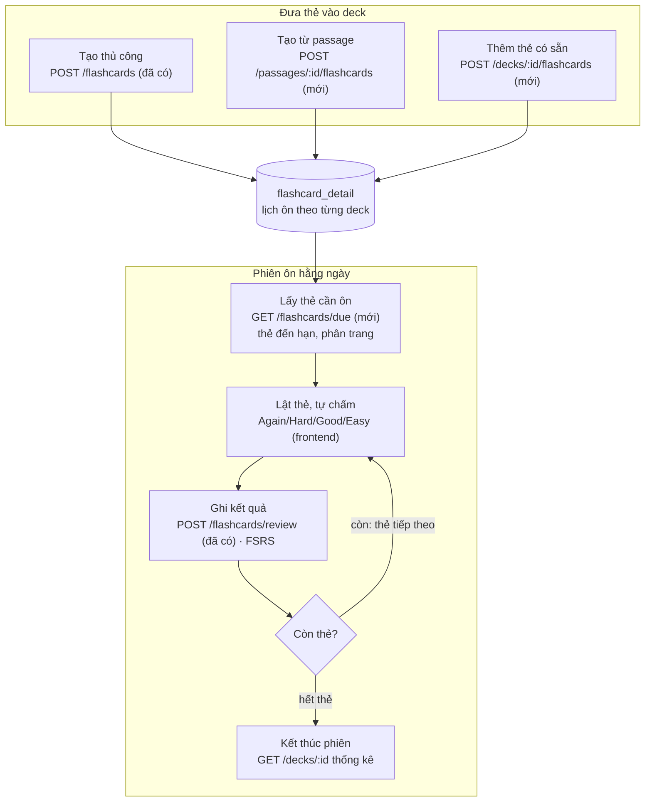

# PLA – Flashcard: luồng hoạt động & API còn thiếu

Ngày cập nhật: 2026-11-20

## Tổng quan

Module flashcard hiện chỉ tạo và ôn được thẻ, chưa có cách biết hôm nay cần ôn thẻ nào và chưa sửa/xóa được gì. Tài liệu này thiết kế 10 API còn thiếu, quan trọng nhất là danh sách thẻ đến hạn.

**Đã có**

| Method | Endpoint | Ghi chú |
| --- | --- | --- |
| GET | `/api/v1/flashcards` | Mọi thẻ nằm trong các deck của tôi, chỉ có `id`, `frontContent`, `backContent` |
| POST | `/api/v1/flashcards` | Tạo thẻ vào 1 deck |
| POST | `/api/v1/flashcards/review` | Chấm 1–4 cho 1 thẻ trong 1 deck, cập nhật FSRS |
| GET / POST | `/api/v1/decks` | Danh sách / tạo deck |
| GET | `/api/v1/decks/{deckId}/flashcards` | Thẻ trong deck, không kèm thông tin lịch ôn |

**Lịch ôn gắn với cặp (deck, thẻ), không gắn với thẻ.** Các trường FSRS nằm ở `flashcard_detail`, nên cùng một thẻ ở 2 deck có 2 lịch ôn độc lập. Mọi API ôn tập và gỡ thẻ đều phải nhận cả `deckId` và `flashCardId`.

**Vấn đề cần sửa trước: thẻ đang dùng chung giữa các user.** `FlashCardService.createFlashCard` gọi `findByContent(front, back)`, truy vấn này tìm trên toàn bảng `flashcard`, không lọc theo người tạo. Nếu user B tạo thẻ trùng nội dung với user A, B sẽ dùng chung dòng thẻ của A. Khi đó nếu A sửa hoặc xóa thẻ, thẻ trong deck của B cũng bị đổi theo. Đề xuất:

1. Đổi `findByContent` thành `findByOwnerAndContent(userId, front, back)`, chỉ tái sử dụng thẻ do chính user tạo.
2. Với dữ liệu cũ đã dùng chung, API sửa thẻ áp dụng **copy-on-write**: nếu thẻ còn nằm trong deck của user khác thì tạo thẻ mới cho user hiện tại và chuyển các dòng `flashcard_detail` của user sang thẻ mới, giữ nguyên lịch ôn.

**Các lỗi nhỏ nên sửa cùng lúc**

- Thẻ mới đang lưu `stability = 0.0`, `difficulty = 0.0`; nên để `NULL` đúng nghĩa "chưa ôn" (`SpacedRepetitionService` xử lý được cả hai).
- `NewFlashCardRequest` thiếu `@Size(max = 255)` cho `frontContent`/`backContent` (DB là `VARCHAR(255)`, nhập dài hơn sẽ ra lỗi 9999) và chưa nhận `example`.
- `FlashCardResponse` thiếu `example`, `sourcePassageId`, `createdAt`.

**Quy ước**: theo mô-đun flashcard hiện tại (MapStruct mapper, `getOwnedDeck` trả `DECK_NOT_FOUND` thay vì ACCESS_DENIED để không lộ id deck của người khác). Thẻ cũng làm tương tự: thẻ không nằm trong deck nào của user thì trả `FLASHCARD_NOT_FOUND`.

## Luồng hoạt động



Vòng ôn chỉ thiếu một mắt xích là `GET /flashcards/due`: API ghi kết quả đã có, nhưng frontend không biết hôm nay cần ôn thẻ nào.

**Luồng 1 – Phiên ôn hằng ngày**

1. Frontend gọi `GET /flashcards/due?deckId=..&page=0&size=20` (bỏ `deckId` để ôn mọi deck).
2. Hiện mặt trước, người học nhớ rồi lật thẻ, tự chấm 1 Again / 2 Hard / 3 Good / 4 Easy.
3. Gọi `POST /flashcards/review` với `deckId`, `flashCardId`, `rating`. Server tính FSRS, lưu `next_review`.
4. Lặp với thẻ tiếp theo. Hết danh sách thì gọi lại API due với `page=0`: nếu `totalElements` còn lớn hơn 0 thì tiếp tục, bằng 0 thì kết thúc. Thẻ đã chấm sẽ rời khỏi danh sách đến hạn (trừ thẻ Again có `next_review` = hôm nay), nên luôn lấy lại trang 0 thay vì tăng `page`, nếu không sẽ bỏ sót thẻ.
5. Kết thúc phiên, hiển thị thống kê bằng `GET /decks/{deckId}`.

Thẻ chấm Again (rating 1) có `next_review` = hôm nay hoặc ngày mai tùy FSRS. Nếu muốn thẻ sai quay lại ngay trong phiên, frontend tự đưa thẻ đó xuống cuối hàng đợi; backend không cần thêm gì.

**Luồng 2 – Đưa thẻ vào deck**

- Thủ công: `POST /flashcards` (đã có).
- Từ bài đọc: ở màn kết quả quiz, bôi đen từ lạ trong passage, chọn deck rồi gọi `POST /passages/{passageId}/flashcards`. Thẻ nhớ `source_passage_id` để sau này mở lại đúng ngữ cảnh.
- Từ thẻ có sẵn: chọn nhiều thẻ trong `GET /flashcards` rồi gọi `POST /decks/{deckId}/flashcards`.

Mọi cách đều tạo dòng `flashcard_detail` trạng thái `NEW` (`next_review` = NULL). Thẻ mới **không** nằm trong `GET /flashcards/due`; người học ôn lần đầu từ danh sách thẻ của deck (`GET /decks/{deckId}/flashcards`), sau lần chấm đầu tiên thẻ mới có `next_review` và vào danh sách đến hạn.

**Luồng 3 – Quản lý**

- Deck: xem chi tiết, đổi tên, xóa (API 2–4).
- Thẻ: sửa nội dung (giữ lịch ôn), xóa khỏi mọi deck, gỡ khỏi 1 deck, học lại từ đầu (API 5–7, 10).
- Xóa deck hoặc gỡ thẻ xong, server dọn các thẻ do user tạo không còn nằm trong deck nào.

## Danh sách API

| # | Method | Endpoint | Mục đích | Ưu tiên |
| --- | --- | --- | --- | --- |
| 1 | GET | `/api/v1/flashcards/due` | Thẻ đến hạn ôn (phân trang) | Cao |
| 2 | GET | `/api/v1/decks/{deckId}` | Chi tiết deck kèm thống kê | Cao |
| 3 | PUT | `/api/v1/decks/{deckId}` | Đổi tên, mô tả deck | Cao |
| 4 | DELETE | `/api/v1/decks/{deckId}` | Xóa deck | Cao |
| 5 | PUT | `/api/v1/flashcards/{flashCardId}` | Sửa nội dung thẻ | Cao |
| 6 | DELETE | `/api/v1/flashcards/{flashCardId}` | Xóa thẻ khỏi mọi deck của tôi | Cao |
| 7 | DELETE | `/api/v1/decks/{deckId}/flashcards/{flashCardId}` | Gỡ thẻ khỏi 1 deck | Cao |
| 8 | POST | `/api/v1/decks/{deckId}/flashcards` | Thêm thẻ có sẵn vào deck khác | Trung bình |
| 9 | POST | `/api/v1/passages/{passageId}/flashcards` | Tạo thẻ từ passage đang đọc | Trung bình |
| 10 | POST | `/api/v1/decks/{deckId}/flashcards/{flashCardId}/reset` | Học lại thẻ từ đầu | Thấp |

Sửa thêm 2 API đã có: `GET /api/v1/decks/{deckId}/flashcards` trả kèm thông tin lịch ôn (`DeckFlashCardResponse` bên dưới) và có phân trang; `POST /api/v1/flashcards/review` trả về `DeckFlashCardResponse` thay cho `FSRSResult` để frontend có luôn trạng thái mới của thẻ.

### Response dùng chung: `DeckFlashCardResponse`

Một thẻ trong một deck, kèm lịch ôn.

```json
{
  "deckId": 3,
  "deckName": "Từ vựng du lịch",
  "flashCardId": 41,
  "frontContent": "itinerary",
  "backContent": "lịch trình",
  "example": "Our itinerary includes three days in Hue.",
  "sourcePassageId": 12,
  "fsrsState": "REVIEW",
  "lapses": 0,
  "lastReviewDate": "2026-11-15",
  "nextReviewDate": "2026-11-20",
  "overdueDays": 0,
  "addedAt": "2026-11-10T03:20:00Z"
}
```

### 1. GET `/api/v1/flashcards/due` – thẻ đến hạn ôn

Tất cả thẻ đến hạn (`next_review <= hôm nay`), có phân trang, sắp `next_review` tăng dần (quá hạn lâu nhất trước), rồi `added_at`. Không gồm thẻ mới chưa ôn lần nào (`next_review` = NULL).

| Query param | Kiểu | Mặc định | Ràng buộc |
| --- | --- | --- | --- |
| `deckId` | Long | mọi deck của tôi | deck phải của tôi, sai trả `DECK_NOT_FOUND` |
| `page` | int | 0 | >= 0 (`PAGE_INVALID`) |
| `size` | int | 20 | 1–100 (`PAGE_SIZE_INVALID`) |

```json
{
  "content": [ { "...": "DeckFlashCardResponse" } ],
  "page": 0,
  "size": 20,
  "totalElements": 14,
  "totalPages": 1
}
```

`PageResponse` dùng chung; `totalElements` là tổng số thẻ đến hạn (để hiển thị "còn 14 thẻ").

### 2. GET `/api/v1/decks/{deckId}` – chi tiết deck

Trả `FlashCardDeckResponse` hiện có + `stats`:

```json
{ "totalCards": 60, "dueToday": 8, "newCards": 12, "learning": 5, "review": 40, "relearning": 3 }
```

Lỗi: `DECK_NOT_FOUND`.

### 3. PUT `/api/v1/decks/{deckId}` – sửa deck

Body dùng lại `NewDeckRequest` (`name` bắt buộc ≤ 100, `description` ≤ 255). Tên mới trùng deck khác của tôi trả `DECK_EXISTED`; trùng chính nó thì cho qua. Bắt `DataIntegrityViolationException` khi `saveAndFlush` để chặn trường hợp 2 request cùng lúc.

### 4. DELETE `/api/v1/decks/{deckId}` – xóa deck

Xóa deck; `flashcard_detail` tự xóa theo `ON DELETE CASCADE`. Sau đó xóa các thẻ do tôi tạo không còn nằm trong deck nào (thẻ mồ côi). Trả 204.

### 5. PUT `/api/v1/flashcards/{flashCardId}` – sửa thẻ

Body `UpdateFlashCardRequest`: `frontContent`, `backContent` (bắt buộc, ≤ 255), `example` (≤ 1000). Không đổi lịch ôn.

1. Thẻ không nằm trong deck nào của tôi → `FLASHCARD_NOT_FOUND`.
2. Nội dung mới trùng một thẻ khác của tôi → `FLASHCARD_CONTENT_EXISTED`.
3. Thẻ còn nằm trong deck của user khác → copy-on-write (mục Tổng quan); ngược lại sửa trực tiếp.

Trả `FlashCardResponse`; `id` có thể khác id cũ nếu đã copy.

### 6. DELETE `/api/v1/flashcards/{flashCardId}` – xóa thẻ

Xóa thẻ khỏi mọi deck của tôi. Chỉ xóa dòng `flashcard` khi không còn deck nào (của bất kỳ ai) tham chiếu. Lỗi: `FLASHCARD_NOT_FOUND`. Trả 204.

### 7. DELETE `/api/v1/decks/{deckId}/flashcards/{flashCardId}` – gỡ thẻ khỏi deck

Xóa dòng `flashcard_detail` (mất lịch ôn của thẻ trong deck này); dọn thẻ nếu thành mồ côi như API 4. Lỗi: `DECK_NOT_FOUND`, `FLASHCARD_DETAIL_NOT_FOUND`. Trả 204.

### 8. POST `/api/v1/decks/{deckId}/flashcards` – thêm thẻ có sẵn vào deck

Body: `{ "flashCardIds": [41, 42] }`, 1–100 id. Mỗi id phải là thẻ đang nằm trong một deck của tôi (nếu không trả `FLASHCARD_NOT_FOUND` và không thêm thẻ nào). Thẻ đã có trong deck thì bỏ qua. Thẻ được thêm bắt đầu lịch ôn mới (`NEW`). Response: `{ "added": 1, "skipped": 1 }`.

### 9. POST `/api/v1/passages/{passageId}/flashcards` – tạo thẻ từ passage

Dùng khi người học bôi đen một từ lạ trong bài đọc. Body = `NewFlashCardRequest` (có thêm `example`). Quyền xem passage kiểm tra qua `QuizAccessService.findViewableQuiz(userId, passage.quizId)`. Thẻ được lưu `source_passage_id`. Lỗi: `PASSAGE_NOT_FOUND`, `ACCESS_DENIED`, `DECK_NOT_FOUND`, `FLASHCARD_DETAIL_EXISTED`.

### 10. POST `/api/v1/decks/{deckId}/flashcards/{flashCardId}/reset` – học lại từ đầu

Đưa dòng `flashcard_detail` về trạng thái ban đầu: `fsrs_state = NEW`, `stability`, `difficulty`, `last_review`, `next_review` = `NULL`, `lapses = 0`. Trả `DeckFlashCardResponse`.

## Phần cần thêm trong code

### ErrorCode mới (nhóm `// Validation Errors - flashcard` và `// Validate Errors - deck`)

Dải 1112–1116 đã dành cho module tiến độ, nên flashcard bắt đầu từ 1117.

| Mã | Tên | HTTP | Thông báo |
| --- | --- | --- | --- |
| 1117 | `FRONT_CONTENT_SIZE` | 400 | Mặt trước tối đa 255 kí tự |
| 1118 | `BACK_CONTENT_SIZE` | 400 | Mặt sau tối đa 255 kí tự |
| 1119 | `FLASHCARD_EXAMPLE_SIZE` | 400 | Ví dụ tối đa 1000 kí tự |
| 1120 | `FLASHCARD_DETAIL_NOT_FOUND` | 404 | Thẻ không có trong deck này |
| 1121 | `FLASHCARD_CONTENT_EXISTED` | 400 | Bạn đã có thẻ với nội dung này |
| 1124 | `FLASHCARD_IDS_EMPTY` | 400 | Danh sách thẻ không được để trống |
| 1125 | `FLASHCARD_IDS_TOO_MANY` | 400 | Mỗi lần thêm tối đa 100 thẻ |

Dùng lại: `FLASHCARD_NOT_FOUND` (1031), `FLASHCARD_DETAIL_EXISTED` (1028), `DECK_NOT_FOUND` (1046), `DECK_EXISTED` (1045), `PASSAGE_NOT_FOUND` (1079), `ACCESS_DENIED` (1002), `RATING_*`.

### Repository

`FlashCardDetailRepository`:

- `findDue(userId, deckId, today, Pageable)` và `findNew(userId, deckId, Pageable)`: `JOIN FETCH d.flashCard JOIN FETCH d.deck`, lọc `d.deck.user.id = :userId AND (:deckId IS NULL OR d.id.deckId = :deckId)`.
- `countDue(...)`, `countNew(...)`, `countStatsByDeck(deckId, today)` (native, `COUNT(*) FILTER`).
- `findAllByFlashCardIdAndUserId(flashCardId, userId)` cho API 5, 6.
- `existsByFlashCardIdAndDeckUserIdNot(flashCardId, userId)` để biết thẻ có đang dùng chung không.

`FlashCardRepository`:

- Thay `findByContent` bằng `findByOwnerAndContent(userId, front, back)`.
- `deleteOrphansCreatedBy(userId)`: `DELETE FROM flashcard f WHERE f.created_by = :userId AND NOT EXISTS (SELECT 1 FROM flashcard_detail d WHERE d.flashcard_id = f.id)`.

### Migration `V5__flashcard_due_index.sql`

Không bắt buộc nhưng nên có:

```sql
-- Thẻ chưa ôn lần nào: đưa stability/difficulty về NULL thay cho 0.0
UPDATE flashcard_detail
SET stability = NULL, difficulty = NULL
WHERE last_review IS NULL;

-- Tìm thẻ trùng nội dung theo người tạo (findByOwnerAndContent)
CREATE INDEX idx_flashcard_owner_content
    ON flashcard (created_by, LOWER(front_content), LOWER(back_content));
```

`idx_fc_detail_due (deck_id, next_review)` đã có sẵn từ V1 cho API 1.

### Test cần viết

- [ ] `due`: đúng thứ tự quá hạn trước; phân trang đúng `page` / `size` / `totalElements`; không có thẻ mới; không lẫn thẻ của user khác; deck của người khác trả 1046.
- [ ] Sửa / xóa deck: thành công, trùng tên 1045, deck người khác 1046, xóa deck dọn thẻ mồ côi.
- [ ] Sửa thẻ: thành công; thẻ dùng chung với user khác → user kia vẫn thấy nội dung cũ và lịch ôn của mình giữ nguyên; trùng nội dung 1121; vượt 255 kí tự 1117/1118.
- [ ] Xóa thẻ, gỡ thẻ: thành công, 1031, 1120, thẻ dùng chung không bị xóa khỏi deck người khác.
- [ ] Thêm thẻ có sẵn: đếm `added` / `skipped`, danh sách rỗng 1124, quá 100 id 1125, một id không hợp lệ thì không thêm gì.
- [ ] Tạo từ passage: lưu đúng `source_passage_id`, passage không tồn tại 1079, passage của quiz người khác 1002.
- [ ] Reset: các trường FSRS về ban đầu, thẻ biến mất khỏi `due` (next_review = NULL).
