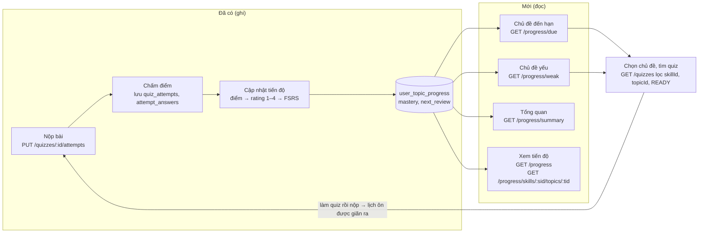

# PLA – Tiến độ học theo chủ đề: luồng hoạt động & API

Ngày cập nhật: 2026-11-20

## Tổng quan

Dữ liệu tiến độ đã được ghi, nhưng chưa có API nào để đọc ra. Tài liệu này thiết kế 5 API đọc `user_topic_progress` để người dùng biết hôm nay cần ôn chủ đề nào, chủ đề nào đang yếu và tiến độ tổng thể.

**Hiện trạng code**

- Khi nộp bài (`PUT /api/v1/quizzes/{id}/attempts`), `QuizAttemptService` gọi `TopicProgressService.recordAttempt`. Hàm này cập nhật số lượt, số câu, `mastery` và lịch FSRS của cặp (skill, topic) của quiz.
- `UserTopicProgressRepository` mới có `insertIfAbsent` và `findByIdForUpdate`, chưa có query đọc nào.
- DB đã có sẵn 2 index cho đúng các truy vấn cần làm: `idx_progress_due (user_id, next_review)` và `idx_progress_weak (user_id, skill_id, mastery)`.

**Quy ước chung cho cả module**

- Base path: `/api/v1/progress`. Người dùng luôn lấy từ token (`@AuthenticationPrincipal CustomUserDetail`), không nhận `userId` từ request, nên không có lỗi ACCESS_DENIED: chỉ đọc được tiến độ của chính mình.
- Đơn vị tiến độ là cặp **(skill, topic)**. Cùng một topic học ở Reading và Listening là 2 dòng riêng.
- "Hôm nay" = `LocalDate.now()` theo múi giờ server, giống cách `SpacedRepetitionService` đang tính `next_review`. Nên cố định `user.timezone: Asia/Ho_Chi_Minh` trong `application.yml` để hai bên khớp nhau.
- Chủ đề chưa từng làm quiz thì chưa có dòng trong `user_topic_progress`. Các API dưới đây chỉ trả chủ đề đã học; gợi ý chủ đề mới nằm ngoài phạm vi tài liệu này.
- Code đặt theo cấu trúc hiện có: `controllers/quiz/TopicProgressController`, mở rộng `services/quiz/TopicProgressService` (hoặc tách `TopicProgressQueryService` cho phần đọc), DTO ở `dto/request/Quiz` và `dto/response/quiz`, mapper static `TopicProgressMapper`.

## Luồng hoạt động



Vòng lặp: API đọc chỉ ra chủ đề cần ôn, người học làm quiz của chủ đề đó, lượt nộp mới lại cập nhật lịch ôn.

**Luồng 1 – Ôn chủ đề đến hạn (màn hình chính mỗi ngày)**

1. Mở app, frontend gọi `GET /progress/summary` để hiển thị "Hôm nay có 3 chủ đề cần ôn" và chuỗi ngày học.
2. Bấm vào, frontend gọi `GET /progress/due` lấy danh sách, chủ đề quá hạn lâu nhất ở đầu.
3. Chọn 1 chủ đề, frontend gọi `GET /quizzes?skillId=..&topicId=..&status=READY` (bộ lọc đã có trong `QuizSearchRequest`). Không có quiz nào thì tạo mới (sau này là sinh bằng AI).
4. Làm bài và nộp, `TopicProgressService.recordAttempt` tính lại `next_review`.
5. Nếu điểm tốt, `next_review` lùi ra sau hôm nay và chủ đề biến mất khỏi danh sách đến hạn; điểm dưới 2.5 (rating 1) thì lịch ngắn lại và `lapses` tăng.

**Luồng 2 – Luyện chủ đề yếu**: giống luồng 1 nhưng bước 2 gọi `GET /progress/weak`. Dùng cho mục "Gợi ý luyện thêm" khi đã ôn hết chủ đề đến hạn.

**Luồng 3 – Xem tiến độ**: `GET /progress` cho trang tổng hợp (lọc theo skill, nhóm chủ đề), bấm 1 dòng mở `GET /progress/skills/{skillId}/topics/{topicId}` để xem điểm qua các lượt.

## Danh sách API

| # | Method | Endpoint | Mục đích | Ưu tiên |
| --- | --- | --- | --- | --- |
| 1 | GET | `/api/v1/progress/due` | Chủ đề đến hạn ôn (hôm nay và quá hạn) | Cao |
| 2 | GET | `/api/v1/progress/weak` | Chủ đề yếu cần luyện thêm | Cao |
| 3 | GET | `/api/v1/progress/summary` | Số liệu tổng quan cho dashboard | Cao |
| 4 | GET | `/api/v1/progress` | Toàn bộ tiến độ, phân trang, lọc và sắp xếp | Trung bình |
| 5 | GET | `/api/v1/progress/skills/{skillId}/topics/{topicId}` | Chi tiết một cặp (skill, topic) kèm các lượt làm gần nhất | Trung bình |

### Response dùng chung: `TopicProgressResponse`

API 2, 4 trả về danh sách phần tử có dạng này (API 1 dùng bản rút gọn, xem bên dưới). Skill dùng lại `RefResponse { id, name }`; topic dùng một bản rút gọn để tránh lặp dữ liệu topic group.

```json
{
  "skill": { "id": 2, "name": "Reading" },
  "topic": { "id": 15, "slug": "travel", "nameVi": "Du lịch", "nameEn": "Travel", "cefrLevel": "B1" },
  "attemptsCount": 4,
  "questionsAnswered": 40,
  "questionsCorrect": 26,
  "mastery": 65.00,
  "fsrsState": "REVIEW",
  "lapses": 1,
  "stability": 6.31,
  "difficulty": 5.42,
  "lastReviewDate": "2026-11-14",
  "nextReviewDate": "2026-11-19",
  "lastPracticedAt": "2026-11-14T08:12:40Z",
  "overdueDays": 1,
  "retrievability": 0.87
}
```

- `overdueDays` = số ngày từ `nextReviewDate` đến hôm nay; âm nghĩa là còn bao nhiêu ngày nữa mới đến hạn; `null` nếu chưa có lịch.
- `retrievability` = khả năng còn nhớ hôm nay (0–1), tính bằng `spacedRepetitionService.retrievability(số ngày từ lastReviewDate, stability)`, làm tròn 2 chữ số. Không lưu DB.

### 1. GET `/api/v1/progress/due` – chủ đề đến hạn ôn

Trả các cặp có `next_review <= hôm nay`, quá hạn lâu nhất lên đầu; cùng ngày thì `mastery` thấp trước. Dùng index `idx_progress_due`.

| Query param | Kiểu | Mặc định | Ràng buộc |
| --- | --- | --- | --- |
| `page` | int | 0 | ≥ 0 (`PAGE_INVALID`) |
| `size` | int | 20 | 1–100 (`PAGE_SIZE_INVALID`) |

Response: `ApiResponse<PageResponse<DueTopicProgressResponse>>`, mỗi phần tử chỉ gồm cặp (skill, topic) và số ngày quá hạn:

```json
{
  "skill": { "id": 2, "name": "Reading" },
  "topic": { "id": 15, "slug": "travel", "nameVi": "Du lịch", "nameEn": "Travel", "cefrLevel": "B1" },
  "overdueDays": 1
}
```

`overdueDays` = số ngày từ `next_review` đến hôm nay (0 = đến hạn hôm nay). Danh sách rỗng là bình thường (200), không phải lỗi.

### 2. GET `/api/v1/progress/weak` – chủ đề yếu

Trả các cặp có `mastery < threshold` và đã làm ít nhất `minAttempts` lượt, sắp `mastery` tăng dần rồi `lapses` giảm dần. Điều kiện `minAttempts` tránh việc 1 lượt làm tệ đã bị xếp vào nhóm yếu. Dùng index `idx_progress_weak`.

| Query param | Kiểu | Mặc định | Ràng buộc |
| --- | --- | --- | --- |
| `skillId` | Short | không lọc | `SKILL_NOT_FOUND` |
| `threshold` | BigDecimal | 60 | 0–100 (`PROGRESS_THRESHOLD_INVALID`) |
| `minAttempts` | int | 2 | 1–50 (`PROGRESS_MIN_ATTEMPTS_INVALID`) |
| `limit` | int | 10 | 1–50 (`PROGRESS_LIMIT_INVALID`) |

Response: `ApiResponse<List<TopicProgressResponse>>` (không phân trang, chỉ lấy top `limit`).

### 3. GET `/api/v1/progress/summary` – tổng quan

Không có tham số. Gồm 3 truy vấn tổng hợp trên `user_topic_progress` và 1 truy vấn trên `quiz_attempts` để tính chuỗi ngày học.

```json
{
  "topicsStudied": 12,
  "dueToday": 3,
  "overdue": 2,
  "averageMastery": 68.40,
  "questionsAnswered": 380,
  "questionsCorrect": 262,
  "attemptsCount": 41,
  "currentStreakDays": 5,
  "bySkill": [
    { "skill": { "id": 1, "name": "Listening" }, "topicsStudied": 4, "averageMastery": 61.25, "due": 1 },
    { "skill": { "id": 2, "name": "Reading" }, "topicsStudied": 8, "averageMastery": 72.00, "due": 2 }
  ],
  "upcoming": [
    { "date": "2026-11-21", "count": 2 },
    { "date": "2026-11-22", "count": 0 }
  ]
}
```

- `dueToday` = số cặp có `next_review = hôm nay`; `overdue` = `next_review < hôm nay`.
- `averageMastery` = trung bình `mastery` của các cặp đã học (không tính theo số câu).
- `bySkill` luôn trả đủ mọi skill, skill chưa học có số liệu 0 để frontend vẽ biểu đồ ổn định.
- `upcoming` = 7 ngày kế tiếp (từ ngày mai), ngày không có lịch trả `count = 0`.
- `currentStreakDays` = số ngày liên tiếp, tính lùi từ hôm nay (hoặc hôm qua nếu hôm nay chưa làm), có ít nhất 1 lượt `submitted_at`. Chỉ đọc 60 ngày gần nhất; quy đổi `timestamptz` sang ngày theo múi giờ `Asia/Ho_Chi_Minh`.
- User chưa học gì vẫn nhận 200 với mọi số liệu bằng 0.

### 4. GET `/api/v1/progress` – toàn bộ tiến độ

Trang "Tiến độ của tôi". Request DTO `ProgressSearchRequest` theo mẫu `AttemptSearchRequest`.

| Query param | Kiểu | Mặc định | Ràng buộc |
| --- | --- | --- | --- |
| `skillId` | Short | không lọc | `SKILL_NOT_FOUND` |
| `topicGroupId` | Long | không lọc | lọc theo `topics.group_id` |
| `fsrsState` | FsrsState | không lọc | sai giá trị enum trả lỗi 400 chuẩn của Spring |
| `sort` | String | `NEXT_REVIEW` | `NEXT_REVIEW` / `MASTERY_ASC` / `MASTERY_DESC` / `LAST_PRACTICED` (`PROGRESS_SORT_INVALID`) |
| `page`, `size` | int | 0, 20 | như API 1 |

Dùng `Specification` giống `QuizService` vì có nhiều bộ lọc tùy chọn. `NEXT_REVIEW` sắp tăng dần, `NULLS LAST`.

### 5. GET `/api/v1/progress/skills/{skillId}/topics/{topicId}` – chi tiết

Trả `TopicProgressDetailResponse` = các trường của `TopicProgressResponse` + `recentAttempts`: tối đa 10 lượt gần nhất của user trên các quiz có cùng `skill_id` và `topic_id`, mỗi lượt gồm `attemptId`, `quiz { id, name = title }`, `correctCount`, `totalQuestions`, `score` (thang 10, dùng `TopicProgressService.calculateScore`) và `submittedAt`.

- Chưa có dòng tiến độ cho cặp này → 404 `PROGRESS_NOT_FOUND`.
- Frontend dùng màn này để vẽ đường điểm qua các lượt và hiển thị ngày ôn kế tiếp.

## Phần cần thêm trong code

Không cần migration mới: bảng và index đã có đủ từ V1.

### ErrorCode mới (nhóm `// Progress exception`)

Mã lớn nhất hiện tại là 1111. Tài liệu Flashcard dùng dải tiếp theo (từ 1117) để hai phần làm song song không trùng mã.

| Mã | Tên | HTTP | Thông báo |
| --- | --- | --- | --- |
| 1112 | `PROGRESS_NOT_FOUND` | 404 | Bạn chưa có tiến độ cho chủ đề này |
| 1113 | `PROGRESS_THRESHOLD_INVALID` | 400 | Ngưỡng mastery phải từ 0 đến 100 |
| 1114 | `PROGRESS_MIN_ATTEMPTS_INVALID` | 400 | Số lượt làm tối thiểu phải từ 1 đến 50 |
| 1115 | `PROGRESS_LIMIT_INVALID` | 400 | Số lượng kết quả phải từ 1 đến 50 |
| 1116 | `PROGRESS_SORT_INVALID` | 400 | Kiểu sắp xếp không hợp lệ |

Dùng lại: `SKILL_NOT_FOUND`, `PAGE_INVALID`, `PAGE_SIZE_INVALID`.

### Repository

`UserTopicProgressRepository` (thêm `JpaSpecificationExecutor` cho API 4):

- `findDue(userId, today, Pageable)`: JPQL `WHERE p.id.userId = :userId AND p.nextReviewDate <= :today`, không JOIN FETCH nên không cần `countQuery` (skill, topic nạp lazy khi map).
- `findWeak(userId, skillId, threshold, minAttempts, Pageable.ofSize(limit))`.
- `summarize(userId, today)` và `summarizeBySkill(userId, today)`: native query dùng `COUNT(*) FILTER (WHERE ...)`, trả về interface projection.
- `countUpcoming(userId, from, to)`: `GROUP BY next_review`; service tự điền ngày thiếu bằng 0.

`QuizAttemptRepository`:

- `findSubmittedDates(userId, since)`: native `SELECT DISTINCT (submitted_at AT TIME ZONE 'Asia/Ho_Chi_Minh')::date ... ORDER BY 1 DESC` cho chuỗi ngày học.
- `findRecentByUserAndSkillTopic(userId, skillId, topicId, Pageable.ofSize(10))` cho API 5.

### Test cần viết

`TopicProgressControllerTest` theo mẫu integration test hiện có (Testcontainers + `JdbcTemplate` chèn sẵn dòng `user_topic_progress` với `next_review` tương đối so với hôm nay), mỗi API một `@Nested`:

- [ ] `due`: chỉ trả dòng `next_review <= hôm nay`, đúng thứ tự, không lẫn dữ liệu của user khác, lọc `skillId`, phân trang sai trả 1006.
- [ ] `weak`: lọc theo `threshold` và `minAttempts`, giá trị ngoài khoảng trả đúng `$.code`.
- [ ] `summary`: user mới trả toàn số 0; đếm đúng `dueToday` / `overdue`; `bySkill` đủ 3 skill; `upcoming` đủ 7 ngày; chuỗi ngày học đứt khi thiếu 1 ngày.
- [ ] `list`: từng bộ lọc, từng kiểu sắp xếp, `sort` sai trả 1116.
- [ ] `detail`: thành công kèm `recentAttempts`; cặp chưa học trả 1112.
- [ ] Luồng đầy đủ: nộp bài điểm cao cho một chủ đề đang đến hạn, sau đó `GET /progress/due` không còn chủ đề đó.
